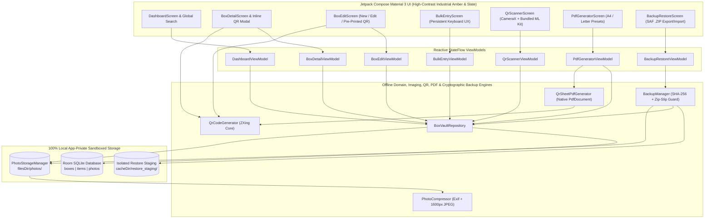

# 📦 BoxVault — 100% Offline, High-Security QR Storage & Inventory Catalog for Android

[](https://github.com/lukasmatusiewicz/BoxVault/actions/workflows/android-ci.yml)
[](app/build/reports/kover/htmlDebug/index.html)
[](app/src/test/java/com/boxvault/app)
[-blue?logo=android)](app/src/main/AndroidManifest.xml)
[](gradle/libs.versions.toml)
[](app/src/main/java/com/boxvault/app/ui)
[](app/src/main/java/com/boxvault/app/data/local)
[-3DDC84?logo=android&logoColor=white)](app/build.gradle.kts)
[](#security--privacy-architecture)

**BoxVault** is a privacy-first, 100% local Android application engineered for cataloging physical storage boxes, garage totes, basement shelves, and workshop bins using immutable QR codes. It operates with **zero network permissions**, **zero cloud accounts**, and **zero recurring costs**—all data, photos, QR generation, barcode scanning, printable PDF rendering, and cryptographic `.zip` backups execute strictly on-device.

---

## ✨ Core Features

### 1. Immutable `boxvault://box/<uuid>` QR Codes (Rename & Move Without Re-Printing)
- Every box is identified by an immutable UUID v4 encoded as `boxvault://box/<uuid>` alongside a human-friendly monospace short code (`BOX-001`, `BOX-002`, …).
- **Decoupled Metadata**: Because the QR code encodes only the immutable UUID, you can rename a box, move it from *Basement Shelf 2* to *Garage Loft*, or edit its contents at any time **without ever re-printing its physical QR sticker**.

### 2. Printable A4 / US Letter PDF QR Sticker Grids (`QrSheetPdfGenerator`)
- Native `android.graphics.pdf.PdfDocument` engine with **zero third-party PDF bloat**.
- **Razor-Sharp Nearest-Neighbor QR Rendering**: QR bitmaps are drawn with `isFilterBitmap = false`, `isAntiAlias = false`, and an explicit white quiet zone (`EncodeHintType.MARGIN = 2`) so module edges print crisp on home laser/inkjet printers.
- **Configurable Grid Presets**:
  - `2 × 4` (**8 labels/page**) — Large heavy-duty storage totes & moving cartons
  - `3 × 7` (**21 labels/page**) — Medium archive & shelf boxes
  - `4 × 10` (**40 labels/page**) — Small hardware drawers & parts organizers
- **Two Label Generation Modes**:
  - **Existing Boxes Mode**: Print labels for boxes already in your Room database.
  - **Pre-Allocated Blank Stickers Mode**: Print a sheet of unassigned `boxvault://box/<new-uuid>` stickers with write-in lines (`Box: _______`, `Loc: _______`) in advance. Stick one onto a new box in the basement, scan it, and BoxVault automatically launches **Assign Pre-Printed QR Label** bound to that exact UUID.

### 3. 100% Offline CameraX + Bundled ML Kit QR Scanner (`QrScannerScreen`)
- Live CameraX `PreviewView` + `ImageAnalysis` pipeline powered by the **bundled** ML Kit Barcode Scanning model (`com.google.mlkit:barcode-scanning:17.3.0`) statically linked into the APK.
- Includes hardware torch/flashlight toggle for dark basements/attics and an instant **Manual Short-Code / QR URI Fallback** (`BOX-001` or `1`) if camera permission is denied.

### 4. Fast Bulk Item Entry UX (`BulkEntryScreen`)
- Purpose-built for standing in front of an open storage box and cataloging 30+ items in under a minute.
- **Persistent Keyboard Focus**: Pressing `ImeAction.Next` / `Enter` or tapping **Add & Keep Typing** inserts the item, increments the session counter, resets quantity to `1`, and keeps the soft keyboard open with focus locked on the Item Name field.

### 5. EXIF-Normalized Photo Downsampling & Atomic Staged `.ZIP` Backups (`BackupManager`)
- **Smart Downsampling (`PhotoCompressor`)**: Photos captured from the camera or imported from the gallery are automatically rotated according to `ExifInterface` orientation tags, downsampled to a maximum of `1600px` on the longest edge, and compressed at `80%` JPEG quality inside `context.filesDir/photos/`.
- **Portable SAF `.ZIP` Export**: Exports `backup_manifest.json` (schema version, timestamps, boxes, items, and photo metadata with per-file **SHA-256 hex digests**) alongside `photos/<filename>` via Android's Storage Access Framework (`CreateDocument("application/zip")`).
- **Atomic Staged Restore (`cacheDir/restore_staging`)**:
  1. Extracts incoming `.zip` archives into an isolated staging directory (`cacheDir/restore_staging`)—**never mutating live Room tables or `filesDir/photos` while reading the stream**.
  2. Enforces strict **Zip-Slip path traversal defense** (`SecurityException` on any `..`, absolute path, or canonical path escape).
  3. Recomputes **SHA-256 checksums** on every staged photo file and verifies 100% match against `backup_manifest.json`.
  4. Atomically swaps the verified data into Room and `PhotoStorageManager`, and unconditionally wipes `cacheDir/restore_staging` in a `finally` block.

---

## 🏗️ System Architecture



---

## 🔒 Security & Privacy Architecture

| Security Control | Implementation in BoxVault | Verification |
| :--- | :--- | :--- |
| **Zero Network Capability** | `<uses-permission android:name="android.permission.INTERNET" tools:node="remove" />` and `ACCESS_NETWORK_STATE` stripped from the merged manifest. | Enforced automatically on every PR/push in [`.github/workflows/android-ci.yml`](.github/workflows/android-ci.yml). |
| **Zero Cloud Auto-Backup** | `android:allowBackup="false"`, `android:fullBackupContent="false"`, and `data_extraction_rules.xml` block silent cloud/D2D extraction. | Inspected in [`AndroidManifest.xml`](app/src/main/AndroidManifest.xml). |
| **Sandboxed Photo Storage** | Photos are stored strictly in `context.filesDir/photos/`. `PhotoStorageManager.resolvePhotoFile()` enforces canonical path checks. | Unit-tested in [`PhotoStorageManagerTest.kt`](app/src/test/java/com/boxvault/app/data/storage/PhotoStorageManagerTest.kt). |
| **Zip-Slip Traversal Defense** | `BackupManager.resolveSafeStagingFile()` rejects `..`, absolute paths, drive prefixes, and canonical escapes outside `cacheDir/restore_staging` with `SecurityException`. | Unit-tested in [`BackupManagerTest.kt`](app/src/test/java/com/boxvault/app/data/backup/BackupManagerTest.kt). |
| **Atomic Staged SHA-256 Restore** | Every extracted photo is hashed with `MessageDigest("SHA-256")` and verified against `backup_manifest.json` in `restore_staging` before any live DB row or photo is touched. | Unit-tested in [`BackupManagerTest.kt`](app/src/test/java/com/boxvault/app/data/backup/BackupManagerTest.kt). |

---

## 🧪 Shift-Left Unit Test Suite & Code Coverage (Kotlinx Kover)

BoxVault uses a shift-left JVM + Robolectric + Room In-Memory test suite (`34` unit tests across `10` test classes) measured by **Kotlinx Kover**:

| Metric | Covered / Total | Percentage |
| :--- | :---: | :---: |
| **Line Coverage** | `1,460 / 1,821` | **80.2%** |
| **Instruction Coverage** | `9,506 / 11,671` | **81.4%** |
| **Class Coverage** | `87 / 101` | **86.1%** |
| **Unit Test Pass Rate** | `34 / 34` | **100.0%** |

### Key Test Suites
- [`BoxVaultDaoTest.kt`](app/src/test/java/com/boxvault/app/data/local/dao/BoxVaultDaoTest.kt) — Room relational queries, cascading deletes, and indexed SQL `LIKE` search across boxes and items.
- [`PhotoStorageManagerTest.kt`](app/src/test/java/com/boxvault/app/data/storage/PhotoStorageManagerTest.kt) — App-private photo read/write, orphan cleanup, and `SecurityException` path traversal rejection.
- [`BoxVaultRepositoryTest.kt`](app/src/test/java/com/boxvault/app/data/repository/BoxVaultRepositoryTest.kt) — Sequential short-code generation, immutable QR payload resolution after box rename/move, and cascading file cleanup.
- [`DashboardViewModelTest.kt`](app/src/test/java/com/boxvault/app/ui/screens/dashboard/DashboardViewModelTest.kt), [`BoxEditAndDetailViewModelTest.kt`](app/src/test/java/com/boxvault/app/ui/screens/boxdetail/BoxEditAndDetailViewModelTest.kt), [`BulkEntryViewModelTest.kt`](app/src/test/java/com/boxvault/app/ui/screens/bulkentry/BulkEntryViewModelTest.kt) — Reactive UI state flows, duplicate short-code guards, and fast bulk item entry session counters.
- [`QrCodeGeneratorTest.kt`](app/src/test/java/com/boxvault/app/util/qr/QrCodeGeneratorTest.kt) — ZXing QR bitmap generation, quiet-zone pixel verification, `QRCodeReader` round-trip decoding, and `QrScannerViewModel` existing vs. pre-printed blank label routing.
- [`QrSheetPdfGeneratorTest.kt`](app/src/test/java/com/boxvault/app/util/pdf/QrSheetPdfGeneratorTest.kt) — Multi-page grid math (`2x4`, `3x7`, `4x10`), pre-allocated blank label generation, and valid `%PDF-` stream generation.
- [`PhotoCompressorTest.kt`](app/src/test/java/com/boxvault/app/util/image/PhotoCompressorTest.kt) — Landscape/portrait `1600px` downsampling, aspect ratio preservation, and EXIF rotation normalization.
- [`BackupManagerTest.kt`](app/src/test/java/com/boxvault/app/data/backup/BackupManagerTest.kt) — Full export → wipe → atomic staged restore round-trip, Zip-Slip `../../evil.sh` rejection preserving live data, and SHA-256 tamper rejection preserving live data.

---

## 📂 Project Structure

```text
BoxVault/
├── .github/workflows/
│   └── android-ci.yml                  # GitHub Actions CI: Build, Unit Tests, Kover Coverage & Zero-Network Audit
├── app/
│   ├── build.gradle.kts                # Android App, Room KSP, Compose, CameraX, ML Kit, ZXing, Robolectric & Kover
│   └── src/
│       ├── main/
│       │   ├── AndroidManifest.xml     # Hardened offline manifest (INTERNET & ACCESS_NETWORK_STATE removed)
│       │   └── java/com/boxvault/app/
│       │       ├── BoxVaultApplication.kt
│       │       ├── MainActivity.kt
│       │       ├── data/
│       │       │   ├── backup/         # BackupManager (SAF .ZIP export + atomic staged SHA-256 & Zip-Slip restore)
│       │       │   ├── local/          # Room Database, BoxEntity, ItemEntity, PhotoEntity, DAOs & Relations
│       │       │   ├── repository/     # BoxVaultRepository
│       │       │   └── storage/        # PhotoStorageManager (canonical sandboxed file storage)
│       │       ├── ui/
│       │       │   ├── components/     # LocalPhotoThumbnail
│       │       │   ├── navigation/     # BoxVaultDestinations & BoxVaultNavHost
│       │       │   ├── screens/        # dashboard, boxedit, boxdetail, bulkentry, scanner, pdfgenerator, backup
│       │       │   └── theme/          # High-contrast Industrial Amber & Slate Material 3 theme
│       │       └── util/
│       │           ├── image/          # PhotoCompressor (EXIF normalization + max 1600px 80% JPEG downsampling)
│       │           ├── pdf/            # QrSheetPdfGenerator (Native PdfDocument A4/Letter crisp QR grids)
│       │           └── qr/             # QrCodeGenerator (ZXing high-contrast QR bitmap generator)
│       └── test/java/com/boxvault/app/ # 10 JUnit + Robolectric shift-left unit test suites (34 tests)
└── gradle/libs.versions.toml           # Centralized Gradle version catalog
```

---

## 🚀 Build, Test & Coverage Commands

### Prerequisites
- **JDK 21** (e.g., Eclipse Temurin 21)
- **Android SDK Platform 35**

### Run Full Build, Unit Tests & Kover Coverage Report
```bash
# Linux / macOS
./gradlew assembleDebug testDebugUnitTest koverXmlReportDebug koverHtmlReportDebug koverLogDebug

# Windows PowerShell
.\gradlew.bat assembleDebug testDebugUnitTest koverXmlReportDebug koverHtmlReportDebug koverLogDebug
```

### Coverage & Test Report Output Paths
- **Kover HTML Report**: `app/build/reports/kover/htmlDebug/index.html`
- **Kover XML Report**: `app/build/reports/kover/reportDebug.xml`
- **JUnit HTML Report**: `app/build/reports/tests/testDebugUnitTest/index.html`
- **Debug APK**: `app/build/outputs/apk/debug/app-debug.apk`
